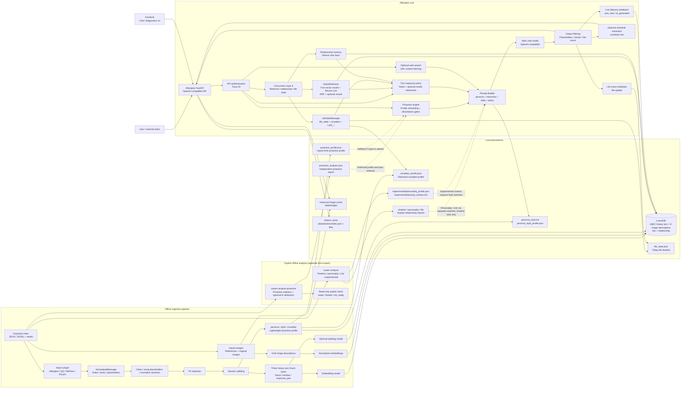

[English](README.md) | [简体中文](readme/README.zh-CN.md) · [中文文档](https://kldhsh123.github.io/Afterglow/zh/) | [English docs](https://kldhsh123.github.io/Afterglow/en/)

<div align="center">

<picture>
  <source media="(prefers-color-scheme: dark)" srcset="assets/brand/afterglow-mark-dark.svg">
  
</picture>

# Afterglow

**Let the warmth of past conversations continue into companionship.**

通过真实聊天记录构建可检索的关系记忆、角色设定与表达风格。结合 RAG、角色上下文和兼容 OpenAI 的 API，让 AI 在新的对话中延续熟悉的交流方式。

Build retrievable relationship memories, persona and expressive style from real chat history. RAG, persona context and an OpenAI-compatible API bring familiar conversational patterns into new exchanges.

<p>
  <a href="https://afterglow.kldhsh.top/">Website</a> ·
  <a href="https://github.com/kldhsh123/Afterglow-Desktop">Windows desktop</a> ·
  <a href="https://kldhsh123.github.io/Afterglow/en/quickstart.html">Quick start</a> ·
  <a href="#architecture">Architecture</a> ·
  <a href="https://kldhsh123.github.io/Afterglow/en/">Documentation</a> ·
  <a href="https://discord.gg/CKrvgCyK4y">Discord</a> ·
  <a href="https://qm.qq.com/cgi-bin/qm/qr?k=7rvmrvR100Is9aAp0ZsjmfiG7e0Cv6ZB&amp;jump_from=webapi&amp;authKey=mEN/epjvPHcT+Sb61/XO0Mi5egs2xJBhZm9Wm5MmgEWrpNa0ZOY3fzUf+pvqfijD">QQ community</a> ·
  <a href="https://afdian.com/a/kldhsh123">Sponsor</a> ·
  <a href="https://github.com/kldhsh123/Afterglow/releases/latest">Releases</a>
</p>

<p>
  <a href="https://github.com/kldhsh123/Afterglow/releases/latest"></a>
  <a href="https://github.com/kldhsh123/Afterglow/blob/main/LICENSE"></a>
  <a href="https://github.com/kldhsh123/Afterglow/commits/main"></a>
  <a href="https://github.com/kldhsh123/Afterglow/issues"></a>
</p>

</div>

---

> [!NOTE]
> **Share your experience.** Bug reports, deployment problems and stories about using Afterglow are welcome. Join our [Discord server](https://discord.gg/CKrvgCyK4y), QQ group `330316577` or use [Discussions](https://github.com/kldhsh123/Afterglow/discussions). With your consent, your story may appear on the [project website](https://afterglow.kldhsh.top/#testimonials), credited or anonymous as you prefer.

> [!IMPORTANT]
> Afterglow generates **AI continuations**, not the original person. Obtain necessary permission, understand what data reaches model providers, and distinguish generated text from real people. Do not impersonate, harass, defraud, publish private chats or present generated replies as someone's own words.
>
> If you are experiencing acute grief, depression or self-harm risk, prioritize people you trust and professional support. Read [Responsible use and privacy](https://kldhsh123.github.io/Afterglow/en/privacy.html).

## What it is

Afterglow is a locally hosted AI companion. It cleans, splits and vectorizes real chats, then combines persona, circadian patterns, Life state and relationship memories to supply relevant historical evidence to a chat model.

It does not fine-tune or modify model weights, restore a person or replace real relationships. Results depend on the amount and distinctiveness of the source chats and the chosen model.

## Core capabilities

| Capability | Description |
|---|---|
| Multiple import sources | QQChatExporter, WeFlow, Douyin, Afterglow Chat, WhatsApp, Telegram and DiscordChatExporter; multi-file profile aggregation |
| Layered hybrid retrieval | Five vector paths across three text-history types, image descriptions and Live memory; RRF with optional rewrite/rerank |
| Persona and state | Persona, contextual style, circadian profile, Life state, optional analysis profiles, relationship memory and response policy |
| Offline relationship analysis | Explicit `xuwen analyze` timeline/personality/Life reports, with independent runtime-consumption switches |
| Proactive tendencies | Separate `xuwen analyze-proactive` report and read-only quality checks before manual opt-in |
| Memory separation | Distinguish human history, new user messages and AI replies to limit persona contamination |
| Open integration | OpenAI-compatible Chat Completions and Responses APIs for external clients |
| Local-first storage | LanceDB, persona and resource caches; PII redaction, Bearer auth and configurable offline model services |

## Ecosystem

- [Afterglow-QQBot](https://github.com/kldhsh123/Afterglow-QQBot): QQ bot adapter
- [Afterglow-WeiXinBot](https://github.com/kldhsh123/Afterglow-WeiXinBot): WeChat bot adapter

## Architecture



- **Offline import:** A/B/C text indexes, persona/style/circadian/lightweight proactive profiles; no automatic relationship reports or proactive AI attribution.
- **Explicit analysis:** `xuwen analyze` generates relationship reports; independent `analyze-proactive` produces proactive tendencies with a read-only quality check.
- **Online conversations:** Five vector paths and Recent Live feed concurrent retrieval/relationship/Life context, then response policy and prompt construction.
- **Runtime use:** Timeline is view-only; personality and Life have independent switches. Proactive scheduling prefers the dedicated report with legacy fallback.
- **Local persistence:** Vectors, persona, circadian/Life state, images and stickers stay in local storage by default.

See the full [architecture guide](https://kldhsh123.github.io/Afterglow/en/architecture.html).

## Quick start

> [!TIP]
> The maintainer recommends running from source for convenient configuration and advanced/experimental features.

### Windows desktop

[Afterglow Desktop](https://github.com/kldhsh123/Afterglow-Desktop) is the Windows desktop client for Afterglow. It bundles the original Afterglow core and a portable Python runtime, bringing the setup wizard, model connections, chat history import, chat and analysis together in one interface. Separate installation directories can each keep their own configuration and data.

### Docker

```bash
mkdir -p ~/afterglow && cd ~/afterglow
curl -fsSLo compose.yaml \
  https://raw.githubusercontent.com/kldhsh123/Afterglow/main/docker/compose.standalone.yaml
# Create initial language and container-access settings; edit existing .env fields manually
if [ ! -f .env ]; then
  printf '%s\n' 'XUWEN_LANGUAGE=en' 'CONFIG_UI_LOCALHOST_ONLY=false' > .env
fi
docker compose pull && docker compose up -d
docker compose logs backend | grep -iE "token|/config/"
```

Copy the session setup token from the logs, open `http://localhost:8000/config/` and complete the eight steps. Configuration goes to the working directory's `.env`; data goes to `.data/`. Then:

```bash
docker compose restart backend
```

See [Docker deployment](https://kldhsh123.github.io/Afterglow/en/docker.html) for mounts, upgrades and operations.

### Run from source

Requires Python 3.12.x (`>=3.12,<3.13`) and [uv](https://github.com/astral-sh/uv). Start with the wizard:

```bash
cd backend
uv sync --extra dev
XUWEN_LANGUAGE=en uv run uvicorn xuwen.chat_api.app:create_app --factory --reload
```

Missing required configuration makes the console print a setup token. Open `http://127.0.0.1:8000/config/`, set identities, models, imports and access password, then restart.

`XUWEN_LANGUAGE=en` is the backend default; `zh-CN` selects Chinese. It controls startup and proactive messages, including rewrites/fallbacks. CLI `--language en` / `--language zh-CN` and HTTP `Accept-Language: en` / `Accept-Language: zh-CN` override their own output scopes. Normal chat follows the conversation and explicit requests. Internal model instructions use English; original evidence and custom prompts are preserved.

The chat UI, wizard and documentation have independent language selectors. First use selects Chinese for Simplified/Traditional Chinese browser preferences and English otherwise. Manual selection is remembered. Wizard provider presets are Chinese-only; empty English services suggest Google chat and OpenAI embeddings/auxiliary models without overwriting saved configuration.

The source startup prefix above uses Bash / WSL syntax. See [Quick start](https://kldhsh123.github.io/Afterglow/en/quickstart.html) for PowerShell syntax, language precedence, the frontend and third-party clients.

## Supported chat formats

| Source | Format | Notes |
|---|---|---|
| [QQChatExporter](https://github.com/shuakami/qq-chat-exporter) | JSON, chunked JSONL | Recommended QQ import  · [Export tutorial](https://kldhsh123.github.io/Afterglow/en/exporting.html#section-2) |
| [WeFlow](https://github.com/hicccc77/weflow) | arkme-json, ChatLab JSONL | Recommended WeChat import  · [Export tutorial](https://kldhsh123.github.io/Afterglow/en/exporting.html#section-3) |
| [Douyin Chat Export](https://github.com/TeamBreakerr/douyin-chat-export) | ChatLab JSON/JSONL | DMs; images remain placeholders  · [Export tutorial](https://kldhsh123.github.io/Afterglow/en/exporting.html#section-4) |
| Afterglow Chat v1 | JSON, typed/bare JSONL | Stable platform-independent format  · [Export tutorial](https://kldhsh123.github.io/Afterglow/en/exporting.html#section-8) |
| WhatsApp | TXT, Markdown | Sender detection; missing-media placeholders  · [Export tutorial](https://kldhsh123.github.io/Afterglow/en/exporting.html#section-5) |
| Telegram Desktop | HTML | Text, replies, media placeholders and local images · [Export tutorial](https://kldhsh123.github.io/Afterglow/en/exporting.html#section-6) |
| [DiscordChatExporter](https://github.com/Tyrrrz/DiscordChatExporter) | JSON | Channel history, identities, replies and media placeholders  · [Export tutorial](https://kldhsh123.github.io/Afterglow/en/exporting.html#section-7) |

Other sources can convert to [Afterglow Chat v1](https://kldhsh123.github.io/Afterglow/en/chat-format.html). A dedicated ingestion plugin is preferable for long-term public support.

## Documentation

- **Getting started:** [Quick start](https://kldhsh123.github.io/Afterglow/en/quickstart.html) · [Configuration](https://kldhsh123.github.io/Afterglow/en/configuration.html) · [Environment](https://kldhsh123.github.io/Afterglow/en/environment.html) · [Docker](https://kldhsh123.github.io/Afterglow/en/docker.html) · [Troubleshooting](https://kldhsh123.github.io/Afterglow/en/troubleshooting.html)
- **Data:** [Export tutorials](https://kldhsh123.github.io/Afterglow/en/exporting.html) · [Imports](https://kldhsh123.github.io/Afterglow/en/importing.html) · [Afterglow Chat v1](https://kldhsh123.github.io/Afterglow/en/chat-format.html) · [Persona templates](https://kldhsh123.github.io/Afterglow/en/persona-templates.html)
- **Advanced:** [Configuration file editor](https://kldhsh123.github.io/Afterglow/en/config-editor.html) · [Analysis, historical images and proactive messages](https://kldhsh123.github.io/Afterglow/en/advanced.html)
- **Reference:** [Architecture](https://kldhsh123.github.io/Afterglow/en/architecture.html) · [API](https://kldhsh123.github.io/Afterglow/en/api.html) · [FAQ](https://kldhsh123.github.io/Afterglow/en/faq.html) · [Privacy](https://kldhsh123.github.io/Afterglow/en/privacy.html)
- **Development:** [Development guide](https://kldhsh123.github.io/Afterglow/en/development.html) · [Contributing](CONTRIBUTING.md) · [Documentation maintenance](https://kldhsh123.github.io/Afterglow/en/documentation.html)

Chinese sources are in `docs/wiki/`; English sources are in `docs/en/`. GitHub Actions builds the [documentation website](https://kldhsh123.github.io/Afterglow); the old Wiki remains a generated compatibility mirror.

## Community and contributions

[Discord](https://discord.gg/CKrvgCyK4y) · [Discussions](https://github.com/kldhsh123/Afterglow/discussions) · [Issues](https://github.com/kldhsh123/Afterglow/issues) · QQ group `330316577` · [Acknowledgements](https://kldhsh123.github.io/Afterglow/en/acknowledgements.html)

Issues and pull requests are welcome. Read the [contribution guide](CONTRIBUTING.md) before modifying the project; the English [development guide](https://kldhsh123.github.io/Afterglow/en/development.html) covers setup, plugins and checks.

## Acknowledgements

Thanks to the [LINUX DO](https://linux.do) community for suggestions that have shaped and refined many implementation details.

Special thanks to [GuDong](https://github.com/GuDong2003), who has used Afterglow since its early versions and continually contributed bug reports and improvement suggestions.

Thanks to everyone who has submitted issues, pull requests, usage feedback and redacted reproduction material.

The issue templates were adapted from [AstrBot](https://github.com/AstrBotDevs/AstrBot/tree/master/.github/ISSUE_TEMPLATE) for Afterglow's reporting process. Both projects use [GNU AGPL v3.0](https://github.com/kldhsh123/Afterglow/blob/main/LICENSE).

Thanks also to [ECYLT](https://www.ecylt.top/) and its anime API relay for past model-service support.

## License

[AGPL-3.0-or-later](LICENSE)

---

<div align="center">
<sub>If Afterglow has helped you preserve some warmth, consider leaving a Star.</sub>
</div>
