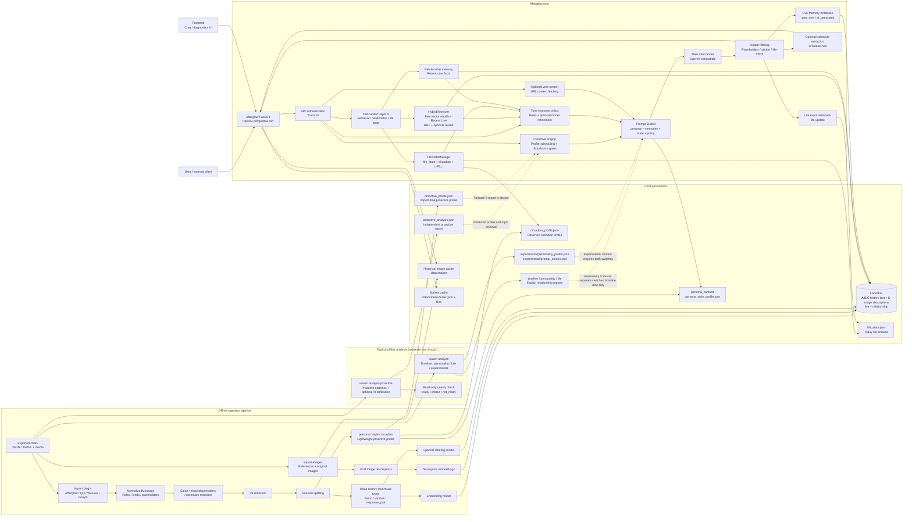
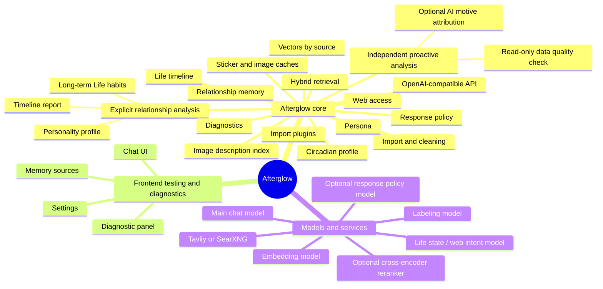

# Architecture

## Key design choices

- **Layered hybrid retrieval:** A/B/C historical text, D `history_images` descriptions and runtime `live_messages` form five vector recall paths. HybridRetriever runs these concurrently and reads Recent Live. Outer Layer A runs retrieval, relationship context and Life decisions in parallel.
- **Optional cross-encoder ranking:** `CROSS_RERANK_ENABLED=true` applies a dedicated model (for example `xop3qwen8breranker` or `qwen3-rerank`) after RRF, before the main prompt. Relevance and latency depend on provider/model; do not assume a universal timing guarantee.
- **Optional Query Rewrite:** A small model expands short colloquial queries into up to three retrieval variants. Hits merge by `(best_rank, distance)` to reduce sparse recall.
- **Optional adaptive chunking:** `CHUNKING_STRATEGY=adaptive` uses topic boundaries through heuristics and an optional small model instead of only fixed 12-message windows. Session concurrency is configurable; runtime depends on corpus and model.
- **Multiple reply bubbles:** Double newlines in one assistant response allow the frontend to display multiple bubbles with separate avatars/timestamps and staggered timing. The API still returns one assistant message. Third-party clients implement splitting if wanted.
- **Three weighting layers:** Recency boost (capped at 15%), warmth weighting and source trust distinguish recent/live/history material.
- **Memory source separation:** `user_new` records user facts; `ai_generated` supports continuity at low weight and does not enter persona/style distillation. Long-term imitation evidence comes from `human_original` history.
- **Controllable AI accumulation:** `AI_GENERATED_LONG_TERM_ENABLED=false` restricts AI semantic memory to the same conversation by default. Enabling it allows low-weight cross-conversation retrieval and potential drift.
- **Growing memory:** Turns are asynchronously written to `live_messages`; storage is not a one-time snapshot.
- **Per-turn response policy:** Rules choose serious, comforting, playful, redirecting, silent, image or sticker behavior, and avoid escalating distress. Optional `RESPONSE_POLICY_MODEL_ENABLED` refinement is bounded: it cannot lower risk or undo protected rule decisions.
- **Silence and delayed display:** A no-reply policy bypasses the main model and returns `finish_reason="silenced"`, the sentinel and `policy.should_reply=false`. Clients apply `policy.reply_delay_seconds`; the backend does not block for presentation delays.
- **Three independent offline paths:** `xuwen import` builds vectors and persona/style/circadian/lightweight proactive profiles; `xuwen analyze` explicitly builds timeline/personality/Life/experimental reports; `xuwen analyze-proactive` independently computes proactive statistics and optional AI motive attribution. Ordinary import/analysis does not trigger proactive attribution.
- **Opt-in report consumption:** Timeline is display-only. Personality enters the prompt only with `ANALYSIS_PERSONALITY_PROMPT_ENABLED=true`; Life habits require `ANALYSIS_LIFE_CONTEXT_ENABLED=true`.
- **Experimental proactive learning:** Disabled and not recommended by default. Scheduling prefers independent `proactive_analysis.json`, falls back to import-time `proactive_profile.json`, then stored windows. Quality checks are read-only, with no AI calls or automatic enablement. Polling rechecks disturbance gates and chooses topic hooks from memory, relationship context and recent cache.
- **Real time and Life state:** Each model call receives current time in the configured zone. A small model maintains daily state for questions about activities, food or sleep. Failed calls write a minimal fallback state to avoid repeated update loops.
- **Optional web access:** Tavily or SearXNG adds public current information when explicitly requested; disabled by default.
- **Large-table indexing:** `uv run python -m xuwen.ingestion.cli index --language en` creates LanceDB IVF_PQ indexes. `cli optimize` merges incremental data. Benefits depend on table size and workload.
- **No fine-tuning:** RAG, prompts and persona cards supply context without modifying model weights.
- **Letter-inspired UI:** Warm paper, dark blue ink, serif typography, ambient particles, human-paced typing and memory-source overlays.
