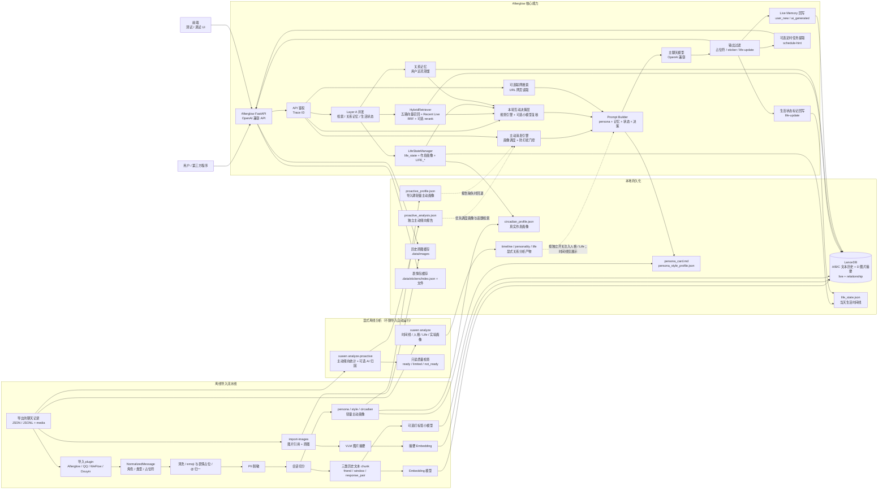

[English](../README.md) | [简体中文](README.zh-CN.md) · [中文文档](https://kldhsh123.github.io/Afterglow/zh/) | [English docs](https://kldhsh123.github.io/Afterglow/en/)

<div align="center">

<picture>
  <source media="(prefers-color-scheme: dark)" srcset="../assets/brand/afterglow-mark-dark.svg">
  
</picture>

# Afterglow · 续温

**把曾经对你好的话，续成往后的陪伴。**

从真实历史聊天中构建可检索的关系记忆、人格与表达风格，  
通过 RAG + Persona + OpenAI 兼容 API，让熟悉的语气继续留在对话里。

<p>
  <a href="https://afterglow.kldhsh.top/">官网</a> ·
  <a href="https://github.com/kldhsh123/Afterglow-Desktop">Windows 桌面版</a> ·
  <a href="https://kldhsh123.github.io/Afterglow/zh/quickstart.html">快速开始</a> ·
  <a href="#整体架构">整体架构</a> ·
  <a href="https://kldhsh123.github.io/Afterglow/zh/">使用文档</a> ·
  <a href="https://discord.gg/CKrvgCyK4y">Discord</a> ·
  <a href="https://qm.qq.com/cgi-bin/qm/qr?k=7rvmrvR100Is9aAp0ZsjmfiG7e0Cv6ZB&amp;jump_from=webapi&amp;authKey=mEN/epjvPHcT+Sb61/XO0Mi5egs2xJBhZm9Wm5MmgEWrpNa0ZOY3fzUf+pvqfijD">QQ 群</a> ·
  <a href="https://afdian.com/a/kldhsh123">赞助支持</a> ·
  <a href="https://github.com/kldhsh123/Afterglow/releases/latest">下载版本</a>
</p>

<p>
  <a href="https://github.com/kldhsh123/Afterglow/releases/latest"></a>
  <a href="https://github.com/kldhsh123/Afterglow/blob/main/LICENSE"></a>
  <a href="https://github.com/kldhsh123/Afterglow/commits/main"></a>
  <a href="https://github.com/kldhsh123/Afterglow/issues"></a>
</p>

</div>

---

> [!NOTE]
> **我们需要你的回音 💌**  
> 无论你是遇到了部署报错、发现了 Bug，还是 Afterglow 帮你在某个瞬间找回了熟悉的温度，我都非常想听听你的体验。  
> 欢迎加入 [Discord 服务器](https://discord.gg/CKrvgCyK4y)或 [QQ 群 `330316577`](https://qm.qq.com/cgi-bin/qm/qr?k=7rvmrvR100Is9aAp0ZsjmfiG7e0Cv6ZB&jump_from=webapi&authKey=mEN/epjvPHcT+Sb61/XO0Mi5egs2xJBhZm9Wm5MmgEWrpNa0ZOY3fzUf+pvqfijD)反馈使用感受；经你同意后，你的故事可以选择署名或完全匿名展示在项目的[官方网站](https://afterglow.kldhsh.top/#testimonials)上。

> [!IMPORTANT]
> Afterglow 生成的是 **AI 续写**，不是原型人物本人。请在取得必要授权、理解隐私外发范围，并能清楚区分 AI 与现实人物的前提下使用。严禁冒名顶替、骚扰、诈骗、公开传播私人聊天，或把生成内容伪装成本人的话。
>
> 如果你正处于剧烈丧失、抑郁或自伤风险中，请优先联系现实中的亲友和专业支持。完整说明见[负责任使用与数据隐私](https://kldhsh123.github.io/Afterglow/zh/privacy.html)。

## 它是什么

Afterglow 是一个本地运行的 AI 朋友系统。它把真实聊天记录清洗、切分并向量化，再结合 persona、作息画像、生活状态与关系记忆，为主模型提供和当前对话相关的历史证据。

它不是微调，也不会改变模型权重；它不是“复活”某个人，更不能替代现实关系。最终效果取决于聊天记录数量、原型人物的语言辨识度和所选模型能力。

## 核心能力

| 能力 | 说明 |
|---|---|
| 多源导入 | 支持 QQChatExporter、WeFlow、Douyin Chat Export、Afterglow Chat 的 JSON / JSONL，以及多文件画像合并 |
| 分层混合检索 | 三类历史文本、历史图片摘要与 Live 记忆五路向量召回，RRF 融合并可选 Query Rewrite / Reranker |
| 人格与状态 | Persona、场景风格、作息画像、Life 状态、可选分析画像、关系记忆与互动决策 |
| 离线关系分析 | `xuwen analyze` 显式生成时间线、人格与 Life 报告；报告是否进入运行时由各自开关控制 |
| 主动消息倾向 | `xuwen analyze-proactive` 单独生成主动倾向报告；只读质量检查通过后再由用户决定是否启用 |
| 记忆分层 | 区分真人历史、用户新消息和 AI 回复，默认防止 AI 内容污染长期人格 |
| 开放接入 | 同时提供 OpenAI Chat Completions 与 Responses API，可接入第三方客户端 |
| 本地优先 | LanceDB、本地 persona 和资源缓存，支持 PII 脱敏、Bearer 鉴权与全离线模型服务 |

## 项目生态

- [Afterglow-QQBot](https://github.com/kldhsh123/Afterglow-QQBot)：QQBot 适配器
- [Afterglow-WeiXinBot](https://github.com/kldhsh123/Afterglow-WeiXinBot)：微信 Bot 适配器

## 整体架构



- **离线导入**：文本生成 A/B/C 三类历史索引，以及 persona、风格、作息和轻量主动画像；不会运行时间线、人格报告或主动消息 AI 归因。
- **显式分析**：`xuwen analyze` 生成时间线、人格和 Life 等关系报告；`xuwen analyze-proactive` 是完全独立的主动倾向入口，生成后可用只读脚本检查是否适合启用。
- **在线对话**：HybridRetriever 并发执行五路向量召回并读取 Recent Live；外层再与关系记忆、生活状态并发，经互动决策组装 Prompt。
- **运行时消费**：时间线当前只供查看；人格与 Life 分别受独立开关控制；主动消息优先使用主动倾向报告，无有效报告时回退导入期轻量画像。
- **本地持久化**：向量、persona、作息、生活状态、图片与表情资源默认保存在本机。

完整能力地图和关键设计见[架构文档](https://kldhsh123.github.io/Afterglow/zh/architecture.html)。

## 快速开始

> [!TIP]
> **开发者备注**：我个人非常推荐源码部署，这方便调整配置，并且高级功能以及试验功能在源码部署的情况下将非常方便配置以及使用。

### Windows 桌面版

[Afterglow Desktop](https://github.com/kldhsh123/Afterglow-Desktop) 是 Afterglow 的 Windows 桌面端。程序自带原版核心和便携 Python，将配置向导、模型连接、聊天记录导入、聊天与分析整合到一个界面。不同安装目录可以分别保存配置和数据。

### Docker

```bash
mkdir -p ~/afterglow && cd ~/afterglow
curl -fsSLo compose.yaml \
  https://raw.githubusercontent.com/kldhsh123/Afterglow/main/docker/compose.standalone.yaml
# 首次创建语言和容器访问配置；已有 .env 请编辑对应字段
if [ ! -f .env ]; then
  printf '%s\n' 'XUWEN_LANGUAGE=zh-CN' 'CONFIG_UI_LOCALHOST_ONLY=false' > .env
fi
docker compose pull && docker compose up -d
docker compose logs backend | grep -iE "token|/config/"
```

首次 Docker 启动前，示例会创建中文语言配置；已有 `.env` 请确认 `XUWEN_LANGUAGE=zh-CN`，仅修改宿主 Shell 环境不会传入容器。复制日志中的一次性 setup token，打开 `http://localhost:8000/config/` 完成 8 步向导。配置会写入当前目录的 `.env`，数据保存在 `.data/`；完成后执行：

```bash
docker compose restart backend
```

完整的挂载、升级和运维说明见 [Docker 部署](https://kldhsh123.github.io/Afterglow/zh/docker.html)。

### 源码运行

需要 Python 3.12.x（`>=3.12,<3.13`） 和 [uv](https://github.com/astral-sh/uv)。首次使用推荐配置向导：

```bash
cd backend
uv sync --extra dev
XUWEN_LANGUAGE=zh-CN uv run uvicorn xuwen.chat_api.app:create_app --factory --reload
```

终端会在缺少关键配置时打印一次性 token。打开 `http://127.0.0.1:8000/config/`，完成身份、模型、聊天导入与访问密码配置，然后重启后端。

后端语言在 `backend/.env` 设置：`XUWEN_LANGUAGE=en`（默认英文）或 `XUWEN_LANGUAGE=zh-CN`（中文），修改后重启。启动提示和主动消息（包括重写及失败兜底）使用此配置。CLI 的 `--language zh-CN` / `--language en` 和 HTTP 的 `Accept-Language: zh-CN` / `Accept-Language: en` 分别覆盖命令输出和接口输出的默认语言；普通聊天仍尊重用户的语言要求。内部模型指令使用英文，聊天原文和用户自定义提示词保留。

上面的源码启动前缀适用于 Bash / WSL；PowerShell 写法、语言优先级、前端启动和第三方客户端接入见[快速开始](https://kldhsh123.github.io/Afterglow/zh/quickstart.html)。

## 支持的聊天格式

| 来源 | 格式 | 说明 |
|---|---|---|
| [QQChatExporter](https://github.com/shuakami/qq-chat-exporter) | JSON、chunked JSONL | 推荐的 QQ 导入方式  · [导出教程](https://kldhsh123.github.io/Afterglow/zh/exporting.html#section-2) |
| [WeFlow](https://github.com/hicccc77/weflow) | arkme-json、ChatLab JSONL | 推荐的微信导入方式  · [导出教程](https://kldhsh123.github.io/Afterglow/zh/exporting.html#section-3) |
| [Douyin Chat Export](https://github.com/TeamBreakerr/douyin-chat-export) | ChatLab JSON、JSONL | 抖音私信导入；图片仅保留占位符  · [导出教程](https://kldhsh123.github.io/Afterglow/zh/exporting.html#section-4) |
| Afterglow Chat v1 | JSON、typed / bare JSONL | 稳定、平台无关的专用中间格式  · [导出教程](https://kldhsh123.github.io/Afterglow/zh/exporting.html#section-8) |
| WhatsApp | TXT、Markdown | 自动识别发送者；缺失媒体保留占位符  · [导出教程](https://kldhsh123.github.io/Afterglow/zh/exporting.html#section-5) |
| Telegram Desktop | HTML | 保留文本、引用、媒体占位符；支持本地图片引用 · [导出教程](https://kldhsh123.github.io/Afterglow/zh/exporting.html#section-6) |
| [DiscordChatExporter](https://github.com/Tyrrrz/DiscordChatExporter) | JSON | 完整频道聊天，支持身份识别、引用回复和媒体占位符  · [导出教程](https://kldhsh123.github.io/Afterglow/zh/exporting.html#section-7) |

其它来源可以转换为 [Afterglow Chat v1](https://kldhsh123.github.io/Afterglow/zh/chat-format.html) 快速接入。长期维护或公开分发时，仍建议实现独立 ingestion plugin 并提交 PR。

## 文档

- **开始使用**：[快速开始](https://kldhsh123.github.io/Afterglow/zh/quickstart.html) · [配置参考](https://kldhsh123.github.io/Afterglow/zh/configuration.html) · [后端环境变量](https://kldhsh123.github.io/Afterglow/zh/environment.html) · [Docker](https://kldhsh123.github.io/Afterglow/zh/docker.html) · [故障排查](https://kldhsh123.github.io/Afterglow/zh/troubleshooting.html)
- **数据导入**：[聊天记录导出教程](https://kldhsh123.github.io/Afterglow/zh/exporting.html) · [导入聊天记录](https://kldhsh123.github.io/Afterglow/zh/importing.html) · [Afterglow Chat v1](https://kldhsh123.github.io/Afterglow/zh/chat-format.html) · [人格模板](https://kldhsh123.github.io/Afterglow/zh/persona-templates.html)
- **高级使用**：[配置文件编辑器](https://kldhsh123.github.io/Afterglow/zh/config-editor.html) · [聊天记录分析、历史图片导入与主动消息](https://kldhsh123.github.io/Afterglow/zh/advanced.html)
- **原理与参考**：[整体架构](https://kldhsh123.github.io/Afterglow/zh/architecture.html) · [后端 API](https://kldhsh123.github.io/Afterglow/zh/api.html) · [FAQ](https://kldhsh123.github.io/Afterglow/zh/faq.html) · [安全与隐私](https://kldhsh123.github.io/Afterglow/zh/privacy.html)
- **开发贡献**：[开发文档](https://kldhsh123.github.io/Afterglow/zh/development.html) · [贡献指南](CONTRIBUTING.zh-CN.md) · [文档维护](https://kldhsh123.github.io/Afterglow/zh/documentation.html)

中文文档源位于 `docs/wiki/`，英文源位于 `docs/en/`；[文档网站](https://kldhsh123.github.io/Afterglow) 由 GitHub Actions 构建发布，旧 Wiki 保留兼容镜像。

## 社区与贡献

[Discord](https://discord.gg/CKrvgCyK4y) · [Discussions](https://github.com/kldhsh123/Afterglow/discussions) · [问题反馈](https://github.com/kldhsh123/Afterglow/issues) · [QQ 群 `330316577`](https://qm.qq.com/cgi-bin/qm/qr?k=7rvmrvR100Is9aAp0ZsjmfiG7e0Cv6ZB&jump_from=webapi&authKey=mEN/epjvPHcT+Sb61/XO0Mi5egs2xJBhZm9Wm5MmgEWrpNa0ZOY3fzUf+pvqfijD) · [致谢](https://kldhsh123.github.io/Afterglow/zh/acknowledgements.html)

Issue 和 PR 都欢迎提交。开始修改前请先阅读[贡献指南](CONTRIBUTING.zh-CN.md)。

## 致谢

感谢 [LINUX DO](https://linux.do) 社区对项目实现提出的建议。Afterglow 的许多实现细节来自这些反馈的反复打磨。

特别感谢 [咕咚](https://github.com/GuDong2003)。他从项目初版开始持续使用 Afterglow，并不断反馈问题和优化建议，推动了多个版本的改进。

感谢所有提交 Issue、PR、使用体验和脱敏复现材料的用户与贡献者。

Issue 模板改编自 [AstrBot](https://github.com/AstrBotDevs/AstrBot/tree/master/.github/ISSUE_TEMPLATE)，已按 Afterglow 的问题反馈流程调整。AstrBot 与 Afterglow 均采用 [GNU AGPL v3.0](https://github.com/kldhsh123/Afterglow/blob/main/LICENSE)。

也感谢 [二次元论坛](https://www.ecylt.top/) 与二次元 API 中转站曾经为项目提供模型服务支持。

## License

[AGPL-3.0-or-later](../LICENSE)

---

<div align="center">

<sub>如果 Afterglow 帮你留住了一些温度，欢迎点一颗 Star。</sub>

</div>
